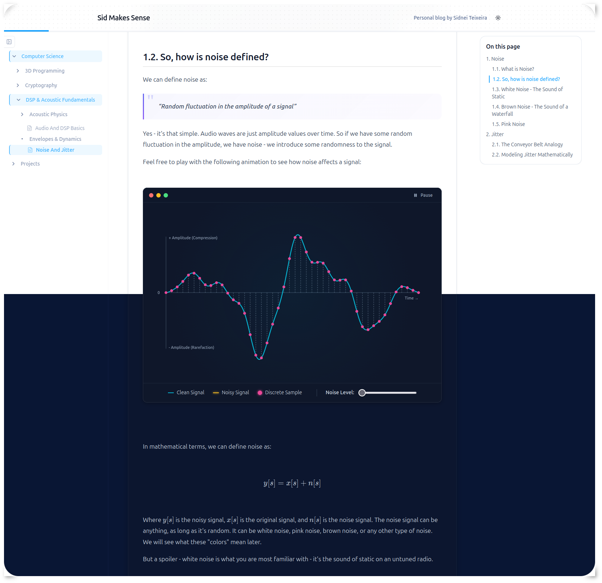

# Articles Website

A static Markdown site built with **Next.js 14** (App Router, static export). Organize content into Notes, Writing, and Devlog sections, then write articles and collections in Markdown. The site supports math, interactive simulations, syntax-highlighted code, and a responsive reading experience.



---

## Table of Contents

- [Project Architecture](#project-architecture)
- [Directory Overview](#directory-overview)
- [Content Structure](#content-structure)
  - [Sections](#sections)
  - [Standalone Articles](#standalone-articles)
  - [Collections](#collections)
  - [Naming & Ordering](#naming--ordering)
- [Markdown Features](#markdown-features)
- [Embedding Simulations](#embedding-simulations)
- [Getting Started](#getting-started)
- [Building & Exporting](#building--exporting)
- [Deployment](#deployment)
- [Environment Variables](#environment-variables)
- [Scripts Reference](#scripts-reference)

---

## Project Architecture

| Layer | Description |
|-------|-------------|
| **Next.js 14 App Router** | Static export (`output: "export"`) — produces a fully static `out/` directory at build time. |
| **Content loader** (`lib/content/`) | Walks `content/`, classifies folders as sections, articles or collections, and converts Markdown to HTML. |
| **Markdown pipeline** (`lib/markdown/`) | unified/remark/rehype pipeline: GFM, math (KaTeX), directives, GitHub alerts, spoilers, code highlighting (Shiki), heading anchors, image handling, iframe wrapping. |
| **Prebuild script** (`scripts/prepare-content.mjs`) | Runs before every build and dev start. Production copies assets only from publicly reachable content; development includes drafts for preview. |
| **Content watcher** (`scripts/watch-content.mjs`) | File watcher process (runs alongside `next dev`) that keeps `public/` in sync as you edit content. |
| **UI shell** (`components/`, `app/`) | Resizable sidebar, tree navigation, article reading shell, table of contents, reading progress bar, dark/light theme. |

### Build output

```
out/                  ← static HTML/CSS/JS (deploy target)
public/
  notes/{slug}/images/         ← one tree per section, mirroring the URL
  _redirects                   ← 301s from the old /articles and /collections URLs
```

---

## Directory Overview

```
content/
  notes/                             # Section; no index.md
    Subject/                         # Structural topic; no index.md
      My-Article/
        index.md                     # Standalone note
        summary.md                   # Optional rich summary
        images/
        simulations/
      My-Collection/
        index.md                     # Collection overview
        1-Chapter-One/
          index.md                   # Article in the collection
  devlog/                            # Section; no index.md
    Unity Game/
      index.md                       # Draft project collection example
      1-Devlog Setup/
        index.md                     # Draft dated entry
  writing/                           # Add when publishing the first essay; no index.md
    My-Essay/
      index.md                       # Standalone essay

lib/
  content/                           # Content walk, builders, metadata, types
  markdown/                          # Markdown pipeline and remark/rehype plugins

styles/
  globals.css                        # Tailwind base + CSS variables + themes
  markdown.css                       # Markdown content styles

scripts/
  prepare-content.mjs                # Prebuild: copy assets + rewrite paths
  watch-content.mjs                  # Dev: file watcher for content changes
```

---

## Content Structure

### Sections

The top-level folders under `content/` are sections: `notes/` for a topic-based knowledge
base, `writing/` for dated essays, and `devlog/` for game development updates. Each section
has its own landing page at `/notes/`, `/writing/`, or `/devlog/`. Section folders are
structural and must not have an `index.md`. `content/writing/` can be created with the first
essay; its landing page already exists.

Below a section, folders without `index.md` can group topics. A folder with `index.md`
becomes a page. Its direct indexed children determine whether it is an article or a
collection. A page's URL always follows its folder path, regardless of its type.

### Standalone Articles

A folder with an `index.md` and no direct child folders with `index.md` is a standalone
article. Writing essays can live directly under `content/writing/`; Notes articles can
sit below topic folders.

```
My-Article/
  index.md       ← main content
  summary.md     ← rich summary (optional but recommended)
  images/        ← assets (auto-copied to public/)
  simulations/   ← interactive HTML demos (auto-copied to public/)
```

**`index.md` frontmatter:**

```yaml
---
status: "published"      # draft | published | archived
title: "My article title" # optional display title; defaults to the folder name
date: "2026-01-15"       # required ISO date for published/archived articles
summary: "One-line description shown on article cards and in SEO metadata."
coverImage: "./images/cover.png"   # optional
---
```

> **Note:** The `summary` frontmatter field is a **short one-liner** for article cards and SEO. For a richer expandable summary shown when clicking the Summary button, create a `summary.md` file alongside `index.md`.

Writing and Devlog articles can also include `tags: ["Unity", "Game Development"]` in their
`index.md` frontmatter. Tags must be a list of non-empty strings; they appear on their
section cards and on the article page. Notes uses its topic tree instead of tags.

The homepage shows a card for each section and up to six recent articles. It includes the
newest article from each section with visible articles, then fills the remaining slots
with the next-newest distinct articles across sections. `featured:` is still accepted by
the loader, but the current homepage does not use it.

---

### Collections

A folder with its own `index.md` and at least one direct child folder with `index.md` is
a collection. The parent `index.md` is its overview; each indexed child is an article or
a nested collection. Notes uses this for multi-chapter subjects.

```
My-Collection/
  index.md            ← collection overview
  1-Introduction/
    index.md
    summary.md
  2-Deep-Dive/
    index.md
    summary.md
    images/
```

**Collection `index.md` frontmatter:**

```yaml
---
status: "published"
title: "My collection title" # optional display title
summary: "Short description used in collection cards."
coverImage: "./images/cover.png"
---
```

**Chapter `index.md` frontmatter:**

```yaml
---
status: "published"
date: "2026-01-15"
summary: "One-liner for this chapter's card."
---
```

Published and archived articles require a real `YYYY-MM-DD` date. Drafts may omit
it while they are being written. Draft content appears in development and is hidden in
production. A draft collection also hides its descendants in production.

For a Devlog project, use `content/devlog/<Project>/index.md` for the project overview
and `content/devlog/<Project>/<Entry>/index.md` for each dated update. The project is a
collection, and `/devlog/` groups its entries under the project title. The existing
`Unity Game` folder is a draft boilerplate example. A Writing essay can use
`content/writing/<Essay>/index.md` without a collection parent.

---

### Naming & Ordering

- Start article bodies at `#` (h1), use `##` for their subsections, and do not
  skip heading levels. The page title is rendered separately from the article body.
- Do not write section numbers into heading text. Article headings and their table
  of contents entries are numbered automatically when rendered.
- Folder names accept numeric prefixes (`1-`, `01-`, `2-`) to control sort order.
- Notes and collection navigation follow folder order: **numeric prefix → alphabetical**.
  Writing and Devlog article lists are ordered by date, newest first.
- Folder names must produce a non-empty, unique URL slug after their numeric prefix and
  punctuation are removed.
- Section and topic folders can omit `index.md`. Once a folder has `index.md`, any
  intermediate folder leading to another indexed page must also have `index.md`.
- Article and collection titles default to the folder name (numeric prefix stripped,
  hyphens/underscores → spaces, title-cased). Optional `title:` frontmatter overrides
  the display title without changing the URL.
- Slugs are generated from folder paths. If two paths produce the same slug, the loader
  rejects the collision.

**URL patterns:** a page's URL is its slug, and the slug is its folder path with numeric
prefixes and punctuation removed — so `content/notes/Computer Science/Cryptography/…`
is served at `/notes/computer-science/cryptography/…/`. The top-level folder is the
*section* (`notes`, `writing`, or `devlog`). A folder's shape (article vs. collection)
never changes its URL. Do not give a section folder its own `index.md` — that would
make it a collection and break the build.

Pages published before the section restructure lived under `/articles/…` and
`/collections/…`; `public/_redirects` sends both to `/notes/…`.

---

## Markdown Features

The pipeline supports a rich superset of standard Markdown:

| Feature | Syntax |
|---------|--------|
| **GitHub Flavored Markdown** | Tables, task lists, strikethrough, etc. |
| **Math (KaTeX)** | Inline: `$E = mc^2$` · Display: `$$…$$` |
| **Code blocks** | Fenced blocks with language tags — syntax highlighted via Shiki |
| **GitHub Alerts** | `> [!NOTE]`, `> [!TIP]`, `> [!IMPORTANT]`, `> [!WARNING]`, `> [!CAUTION]`, `> [!EXERCISE]`, `> [!EXAMPLE]` |
| **Spoilers** | `:::spoiler[Title]` … `:::` — animated accordion |
| **Section breaks** | `===` or `...` on its own line → strong horizontal rule with extra spacing |
| **Heading anchors** | `#` anchor links appear on hover for easy section linking |
| **Iframe simulations** | `<iframe src="simulations/demo.html">` — auto-wrapped in macOS-style window |
| **Images** | Standard `` — auto-path-rewritten for prod/dev |

---

## Embedding Simulations

Interactive HTML/JS simulations can be embedded directly in articles:

1. Create a `simulations/` folder inside your article directory.
2. Place a self-contained HTML file inside (e.g. `demo.html`). Ensure all JS/CSS is inline or bundled — no external dependencies.
3. Embed in Markdown:

```html
<iframe src="simulations/demo.html" width="100%" height="600px"></iframe>
```

The prebuild script automatically copies `simulations/` to `public/` so the paths resolve correctly in production.

**What you get automatically:**
- macOS-style window chrome (dark title bar with traffic light buttons)
- Play / Pause button injected into the title bar
- `requestAnimationFrame` interception for pause/resume support

**Tips for simulation HTML files:**
- Remove any `padding` from `body` and set `border-radius: 0` on root card elements — the iframe window already provides the outer frame.

---

## Getting Started

```bash
npm install
npm run dev
```

Visit [http://localhost:3000](http://localhost:3000). The dev server runs alongside a content watcher that keeps `public/` in sync as you edit articles and simulations.

> **Note:** The first page visit in dev mode is slow (~5–7 s) because Next.js compiles pages on demand and the markdown pipeline is heavy. Subsequent visits within the same session are fast. In production, all pages are prerendered as static HTML at build time.

---

## Building & Exporting

```bash
npm run build
```

This runs:
1. `scripts/prepare-content.mjs` (prebuild hook) — copies assets for publicly reachable content
2. `next build` — compiles the app and generates the static `out/` directory, including sitemap and RSS

---

## Deployment

### Cloudflare Workers

`npm run build` writes the static export to `out/`, then `npm run deploy` (`wrangler deploy`)
publishes it. `wrangler.jsonc` serves `out/` as static assets at the domain root and routes
`/api/*` to `worker/index.ts`, which records article views in the `articles` D1 database.

The site is always served from a domain root, so there is no `basePath` to configure.

### Custom domain

The production canonical URL defaults to `https://articles.sidneiteixeira.com` for
sitemaps, RSS feed links, and canonical URLs. Set `SITE_URL` only when building
for a different domain:

```bash
SITE_URL=https://yourdomain.com npm run build
```

---

## Environment Variables

Create a `.env` (or `.env.local`) file at the project root:

```env
# Giscus comments (optional) — get values from https://giscus.app/
NEXT_PUBLIC_GISCUS_REPO=owner/repo
NEXT_PUBLIC_GISCUS_REPO_ID=R_...
NEXT_PUBLIC_GISCUS_CATEGORY=Announcements
NEXT_PUBLIC_GISCUS_CATEGORY_ID=DIC_...

# Optional override for sitemap/RSS canonical URLs
SITE_URL=https://yourdomain.com
```

---

## Scripts Reference

| Command | Description |
|---------|-------------|
| `npm run dev` | Start dev server + content watcher (hot reload for assets) |
| `npm run dev:next` | Start Next.js dev server only (no watcher) |
| `npm run watch` | Run the content watcher standalone |
| `npm run build` | Prebuild assets → `next build` → static `out/` |
| `npm run start` | Serve the built Next.js output locally |
| `npm run lint` | Run Next.js ESLint checks |
